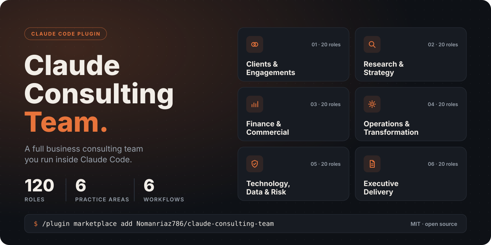

<p align="center">
  
</p>

# Claude Consulting Team: 132 Business Consulting Skills for Claude Code

[](LICENSE)
[](#install)
[](#all-132-skills)
[](#engagement-workflows)

**Claude Consulting Team is a free, open-source Claude Code plugin that gives Claude 132 business consulting skills and 6 end-to-end engagement workflows.** It covers winning clients, strategy, finance, operations, technology risk and executive reporting. Founders, solo consultants, agencies and small teams use it to get structured, consulting-grade analysis on their own business or a client's business without hiring a firm.

## Install

Install as a Claude Code plugin:

```text
/plugin marketplace add Nomanriaz786/claude-consulting-team
/plugin install claude-consulting-team@claude-consulting-team
```

Or install the skills only:

```bash
npx skills add Nomanriaz786/claude-consulting-team
```

Or install manually: clone this repo, then copy `skills/` to `.claude/skills/` and `commands/` to `.claude/commands/` in your project.

## What you can ask Claude to do

Once installed, ask for the outcome in plain language. Claude picks the matching skill.

- "Prep me for a discovery call with a 40-person logistics company tomorrow."
- "Build a 13-week cash flow forecast from these numbers."
- "Our churn went up last quarter. Run a cohort analysis and tell me why."
- "Draft a board paper recommending we enter the German market."
- "Map our order-to-cash process and find the bottleneck."
- "Assess the security and continuity risk of our new payroll vendor."
- "Turn this analysis into a one-page executive summary for the CEO."

## Practice areas

| Practice area | Skills | Typical work |
| --- | --- | --- |
| 01 Clients & Engagements | 22 | Ideal client profile, discovery calls, lead qualification, scoping, fees, proposals, statements of work |
| 02 Research & Strategy | 22 | Issue trees, market sizing, competitor mapping, positioning, growth options, strategy roadmaps |
| 03 Finance & Commercial Performance | 22 | Cash flow forecasts, unit economics, pricing, profitability, sales funnels, churn and retention |
| 04 Operations & Transformation | 22 | Process mapping, bottlenecks, SOPs, supply chain resilience, organisation design, change adoption |
| 05 Technology, Data & Risk | 22 | AI opportunity scans, cyber and vendor risk, data quality, privacy checks, technology due diligence |
| 06 Executive Delivery | 22 | Board papers, executive summaries, decision memos, steering packs, status briefings, handovers |

### New in v1.1: 12 original skills

These skills were written for this project and fill gaps for founders and small teams: fundraising, goal setting, hiring, pay, AI policy and investor reporting.

| Practice area | New skills |
| --- | --- |
| 01 Clients & Engagements | `case-study-writer`, `retainer-designer` |
| 02 Research & Strategy | `okr-builder`, `customer-journey-map` |
| 03 Finance & Commercial Performance | `fundraising-readiness`, `annual-budget-builder`, `business-valuation` |
| 04 Operations & Transformation | `hiring-plan`, `compensation-bands` |
| 05 Technology, Data & Risk | `ai-policy-writer` |
| 06 Executive Delivery | `investor-update`, `crisis-communications` |

## Engagement workflows

Workflows chain several skills in order, with human review checkpoints between steps. Run them as slash commands.

| Command | What it does |
| --- | --- |
| `/discovery-to-proposal` | Turns a first prospect conversation into an approved proposal |
| `/strategy-choice-roadmap` | Turns an open growth question into a strategic roadmap |
| `/commercial-performance-reset` | Diagnoses commercial performance and sets priority actions |
| `/operations-redesign` | Redesigns a core process and prepares it for adoption |
| `/technology-risk-roadmap` | Assesses the technology estate and builds a risk-aware roadmap |
| `/executive-decision-handover` | Secures a decision and hands an executable plan to owners |

## How each skill works

Every skill is a `SKILL.md` file with the same five parts:

1. **When to use it**, so Claude can match your request to the right skill.
2. **What Claude needs**, the inputs to gather before starting.
3. **Method**, a numbered step-by-step approach.
4. **Output format**, the exact shape of the deliverable.
5. **Quality checks**, the tests the result must pass before it counts as done.

## Set up your project

1. Open the business's or client's folder in Claude Code.
2. Copy `templates/client-context.md` to the project root and fill it in. Every skill reads it first.
3. Copy `templates/CLAUDE.md` to the project root. It makes Claude act as the engagement lead and route each request to the narrowest matching skill.
4. Ask for an outcome, or run a workflow.

Deliverables are saved under `outputs/<practice-area>/` in your project.

## Ground rules

1. Run one skill at a time unless a workflow defines the sequence.
2. Use real numbers and cited evidence only. Ask when critical inputs are missing.
3. Mark assumptions, estimates and data gaps where they appear.
4. Check the skill's quality checks before treating a deliverable as complete.
5. Have a human verify calculations, sources and recommendations before anything goes to a client or drives a decision.

## FAQ

### What is Claude Consulting Team?

It is an open-source plugin for Claude Code that adds 132 business consulting skills and 6 multi-step workflows. Each skill teaches Claude one consulting task, such as a cash flow forecast, a stakeholder map or a board paper.

### How do I install Claude skills from a GitHub repo?

In Claude Code, run `/plugin marketplace add Nomanriaz786/claude-consulting-team`, then `/plugin install claude-consulting-team@claude-consulting-team`. You can also run `npx skills add Nomanriaz786/claude-consulting-team`, or copy the `skills/` folder into `.claude/skills/` yourself.

### Does it work in the Claude desktop or web app?

Yes. Zip any single skill folder from `skills/` and upload it as a custom skill in the Claude app settings. The slash-command workflows need Claude Code.

### Is it free? Do I need an API key?

It is free and MIT licensed. It runs inside Claude Code on your existing Claude plan, so no separate API key is needed.

### What is the difference between a skill and a workflow?

A skill does one job, like pricing diagnostics. A workflow runs several skills in a fixed order and pauses for your review between steps, like going from discovery call to signed proposal.

### Can I use it for real client work?

Yes, as a drafting and analysis aid. Every skill separates facts from assumptions and ends with quality checks, but a human should review all numbers and recommendations before they reach a client.

### Can I add my own skills?

Yes. Add a folder under `skills/` with a `SKILL.md` that follows the five-part format, then open a pull request.

## All 132 skills

<details>
<summary>Show every skill name</summary>

`access-control-audit`, `ai-opportunity-scan`, `ai-policy-writer`, `annual-budget-builder`, `application-portfolio-map`, `architecture-fit-check`, `automation-backlog`, `benefits-realisation`, `board-paper`, `bottleneck-removal`, `break-even-model`, `budget-variance-analyst`, `business-continuity-planner`, `business-valuation`, `capacity-planning`, `case-study-writer`, `cash-flow-forecast`, `change-adoption`, `change-impact`, `channel-profitability`, `churn-cohort-analysis`, `client-handover`, `client-kickoff`, `client-profitability`, `client-relationship-manager`, `closeout-pack`, `compensation-bands`, `competitor-mapper`, `contribution-margin`, `cost-structure-analyst`, `crisis-communications`, `customer-insight-synthesiser`, `customer-interview-designer`, `customer-journey-map`, `customer-segmenter`, `cyber-risk-assessment`, `dashboard-requirements-planner`, `data-lineage-mapper`, `data-quality-audit`, `decision-log`, `decision-memo`, `decision-rights`, `delivery-model-selector`, `demand-validator`, `discount-governance`, `discovery-call-facilitation`, `discovery-call-prep`, `discovery-question-design`, `discovery-synthesis`, `engagement-outcomes`, `evidence-synthesiser`, `executive-dashboard`, `executive-summary`, `fee-setting`, `financial-statement-diagnostic`, `fundraising-readiness`, `funnel-diagnostic`, `go-to-market`, `governance-designer`, `growth-options`, `hiring-plan`, `hypothesis-planner`, `ideal-client-profile`, `implementation-roadmap`, `integration-dependency-map`, `inventory-operations`, `investment-case`, `investor-update`, `issue-tree`, `lead-qualification`, `market-landscape`, `market-sizer`, `meeting-brief`, `metric-definition-designer`, `milestone-plan`, `negotiation-prep`, `okr-builder`, `operating-cadence`, `operating-model-design`, `opportunity-prioritiser`, `options-assessment`, `organisation-design`, `positioning-architect`, `price-sensitivity`, `pricing-diagnostic`, `privacy-compliance-check`, `problem-definition`, `process-diagnosis`, `process-mapping`, `product-profitability`, `proposal-writer`, `prospect-fit-screen`, `quality-management`, `recommendation-deck`, `regulatory-obligation-map`, `reporting-control-check`, `research-brief`, `retainer-designer`, `retention-economics`, `revenue-forecast`, `risk-escalation`, `role-clarity`, `sales-capacity-model`, `scenario-modeler`, `scenario-planner`, `scope-boundary-design`, `service-operations`, `speaking-notes`, `stakeholder-mapping`, `stakeholder-update`, `standard-operating-procedures`, `statement-of-work`, `status-briefing`, `steering-pack`, `strategic-choice`, `strategy-roadmap`, `supply-chain-resilience`, `systems-migration-planner`, `technology-due-diligence`, `technology-roadmap-builder`, `technology-stack-assessment`, `transformation-roadmap`, `transition-brief`, `trend-scout`, `unit-economics`, `value-proposition`, `vendor-performance`, `vendor-risk-assessment`, `vendor-selection`, `workflow-redesign`, `working-capital-optimizer`, `workplan-designer`

</details>

## Repo layout

```text
.claude-plugin/   plugin and marketplace manifests
skills/           132 skills, one SKILL.md per folder
commands/         6 engagement workflows
templates/        CLAUDE.md engagement lead and client-context.md
assets/           banner and social preview images
```

## Contributing

New skills, workflows and rules are welcome. Add a skill as `skills/<skill-name>/SKILL.md` using the five-part format above, or a workflow as `commands/<name>.md`, then open a pull request.

## License and credit

The plugin packaging, README, templates and all new contributions are released under the [MIT License](LICENSE).

The original 120 roles and 6 workflows are adapted from "The Complete Claude Business Consulting Team (2026)", a free guide published by LeadPanther. All credit for that content goes to its author. If you are the author and want changes to the credit or the content removed, please open an issue and it will be handled promptly.
